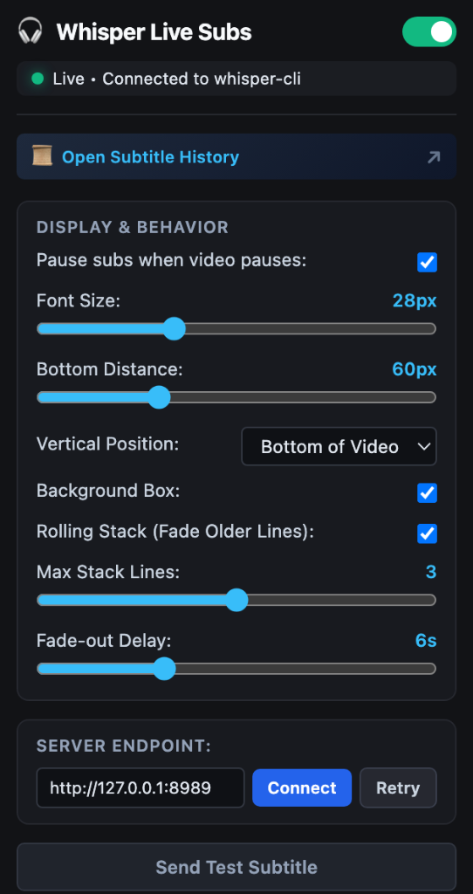
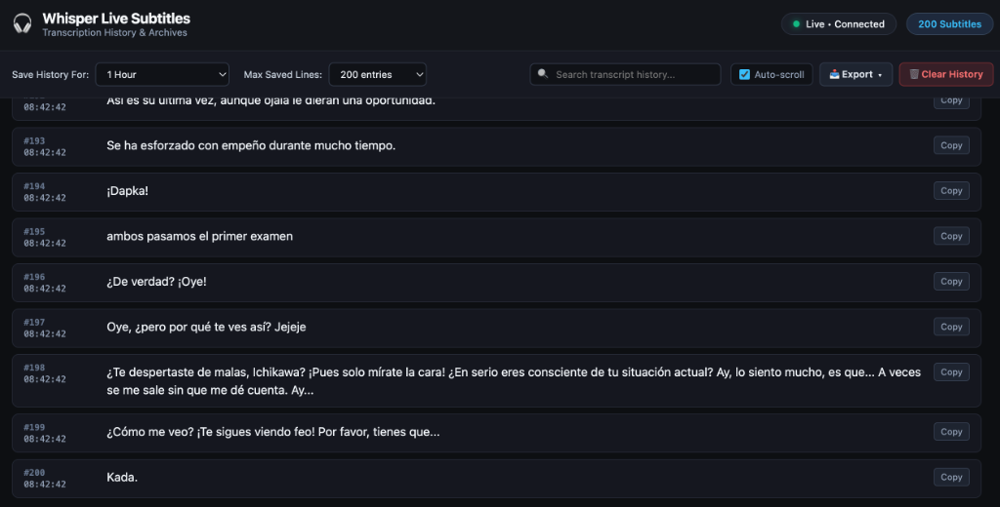

# whisper-cli-sub-injector

Browser extension that displays live subtitles over HTML5 video elements, designed to work alongside [whisper-cli](https://github.com/aramrw/whisper-cli).


## Features

- Automatically detects and binds to videos (works on YouTube, Crunchyroll, Netflix, and other video sites).
- Automatically pauses subtitles when the video is paused, keeping text visible for reading or dictionary lookups.
- Customizable appearance (font size, position, background box, fade-out time, and rolling stack lines).
- Dedicated history page to search, filter, copy, and export previous subtitles (.txt, .srt, .json) with configurable retention.
- Supports fullscreen mode without losing the overlay.

<p align="center">
  
  &nbsp;
  
</p>

## How to Use

1. Download & Run [whisper-cli](https://github.com/aramrw/whisper-cli) with live system audio capture:

```bash
whisper --live --preset live -l ja
```

[whisper-cli](https://github.com/aramrw/whisper-cli) starts a local SSE server at `http://127.0.0.1:8989/events`.

2. The extension connects to the local endpoint automatically and overlays live transcription on the video currently playing in your browser.

## Installation

### Build from source

```bash
git clone https://github.com/aramrw/whisper-cli-sub-injector.git
cd whisper-cli-sub-injector
npm install
npm run build
```

This generates:
- `dist/chrome/` (for Chrome, Brave, Edge)
- `dist/firefox/` (for Firefox)

### Load into browser

**Chrome / Brave / Edge:**
1. Go to `chrome://extensions/`
2. Enable "Developer mode" (top right).
3. Click "Load unpacked" and select the `dist/chrome` folder.

**Firefox:**
1. Go to `about:debugging#/runtime/this-firefox`
2. Click "Load Temporary Add-on..." and select `dist/firefox/manifest.json`.

## License

MIT
